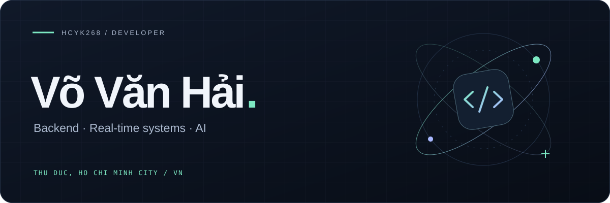

  

### Hey, I'm Hai 👋

Developer based in **Ho Chi Minh City, Vietnam**. Building backends, real-time apps, and the occasional game.

> It always seems impossible until it’s done.

 

### Selected projects

<table>
  <tr>
    <td width="50%" valign="top">
      <h3><a href="https://github.com/hcyk268/trader-hub">↗ TraderHub</a></h3>
      
Real-time chat and crypto market data with an AI assistant.

      SPRING BOOT · REACT · REDIS
    </td>
    <td width="50%" valign="top">
      <h3><a href="https://github.com/hcyk268/mosquizto-backend-service">↗ Mosquizto</a></h3>
      
A flashcard learning backend with smart content recommendations.

      SPRING BOOT · POSTGRESQL · QDRANT
    </td>
  </tr>
  <tr>
    <td width="50%" valign="top">
      <h3><a href="https://github.com/hcyk268/creambuffet">↗ Creambuffet</a></h3>
      
A multiplayer game with a dedicated server and automated deployment.

      GODOT · GDSCRIPT · DOCKER
    </td>
    <td width="50%" valign="top">
      <h3><a href="https://github.com/hcyk268/PetShop">↗ Fetch</a></h3>
      
A pet shop desktop app. Team lead and developer on a group project.

      C# · WPF · SQL SERVER
    </td>
  </tr>
</table>

  <a href="https://github.com/hcyk268?tab=repositories">All repositories →</a>

 

  

